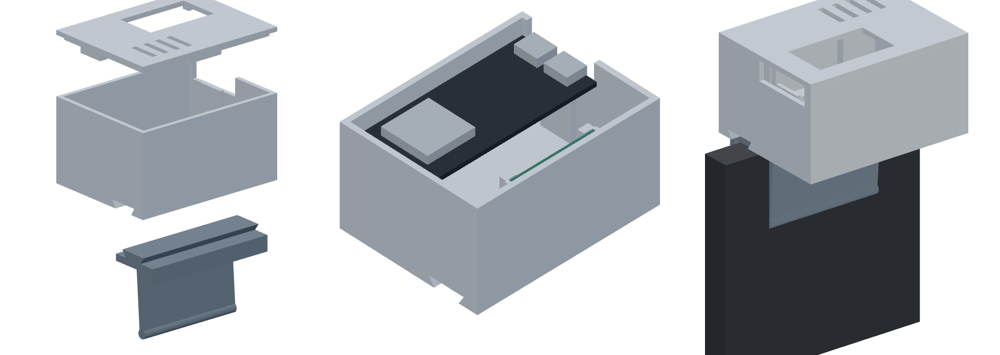

# Radar Auto-Lock

**Your PC locks itself when you walk away and wakes up when you come back.**
A 60 GHz mmWave radar on top of your monitor watches the seat in front of it.
An ESP32-S3 board plugs into the PC as a normal USB keyboard and presses the
lock shortcut for you: Win + L on Windows, Ctrl + Cmd + Q on macOS,
Super + L on Linux.

No camera, no app, no driver, no account. The radar sees through the plastic
case and works in the dark.



> Status: firmware v1.0.0 builds with ESP-IDF v6.0.2 (USB and Bluetooth
> variants, checked in CI) and the presence logic has host tests. Not yet
> validated on every radar firmware build: if something is off, open an issue
> with the output of the `status` command.

## How it behaves

| You | What happens | LED on the board |
|---|---|---|
| Sitting at the desk | Nothing. You do not need to type or move; small movements keep you "present" | Green |
| Gone for 30 s (adjustable) | PC locks | Two white flashes, then blue |
| Walk back and sit down (1 s) | Screen turns on at the sign-in screen (Windows Hello can log you straight in) | One white flash, then green |
| PC went to sleep while you were away | Board wakes the PC over USB | One white flash |
| Press **BOOT** | Pause / resume auto-lock (for a meeting or a movie) | Amber = paused |

It never types your password. Waking only taps the Shift key, which turns the
screen on and shows the sign-in page.

Safety rules built into the firmware:

- If the radar stops sending data, the PC is **not** locked (red blinking LED instead).
- After power-up it only locks once it has actually seen someone at the desk.
- One lock per absence; one wake per return.

## Parts

| Part | Notes | Buy |
|---|---|---|
| 60 GHz presence & tracking radar development kit | 2T2R, 120° × 120° field of view, target positions over UART | [Kymopsis](https://kymopsis.com/product/60ghz-presence-tracking-radar-development-kit/?utm_source=github&utm_medium=readme&utm_campaign=radar-auto-lock) |
| ESP32-S3 board, dual USB-C | Any ESP32-S3 DevKitC-1 style board; the case fits the N16R8 board below | [Kymopsis](https://kymopsis.com/product/esp32-s3-n16r8-development-board/?utm_source=github&utm_medium=readme&utm_campaign=radar-auto-lock) |
| AMS1117-3.3 V module | Clean 3.3 V for the radar (it draws up to 600 mA peaks) | [Kymopsis](https://kymopsis.com/product/ams1117-3-3v-ldo-power-module/?utm_source=github&utm_medium=readme&utm_campaign=radar-auto-lock) |
| Dupont jumper wires, F-F | 8 wires | [Kymopsis](https://kymopsis.com/product/dupont-jumper-wire-kit-120pcs/?utm_source=github&utm_medium=readme&utm_campaign=radar-auto-lock) |
| USB-C cable | Board's **USB** port to the PC | Any |
| 3D-printed case | 3 parts: case, lid, one clip (or the desk foot) | [`enclosure/`](enclosure/) |

No soldering if your radar kit and AMS1117 module come with pin headers.

## Quick start

1. **Wire it** (10 minutes): [docs/wiring.md](docs/wiring.md).
2. **Flash it** from the browser, no install: [docs/setup.md](docs/setup.md#flash).
3. **Plug the board's USB port into your PC.** It shows up as a keyboard called
   "Radar Auto-Lock".
4. **Pick your OS** if you are not on Windows: hold **BOOT** for 3 s. The LED
   flashes cyan 1× Windows, 2× macOS, 3× Linux. Repeat to step through.
5. **Test:** walk away, wait 30 s, the PC locks. Come back, the screen wakes.

Want a different delay or distance? Open the serial console and type
`set away 60` or `set range 0.9`. All settings: [docs/setup.md](docs/setup.md#settings).

### Bluetooth instead of USB

Flash the `-ble` firmware, power the board from any USB charger and pair
"Radar Auto-Lock" like a wireless keyboard. Bluetooth cannot wake a PC from
sleep, so USB is the recommended way. Details in [docs/setup.md](docs/setup.md#bluetooth).

## How it works

```
60 GHz radar ──UART──▶ ESP32-S3 ──USB HID (or BLE HID)──▶ PC: Win+L / Shift
                         │
                         └─ presence state machine:
                            target or point cloud inside the zone?
                            (default: closer than 1.2 m, within ±60°)
```

The radar reports targets and, on most firmwares, a point cloud as x/y/z
coordinates in TinyFrame packets (type `0x0A04` targets, `0x0A08` points). The
ESP32 counts what falls inside the zone in front of the monitor. Small
movements of a seated person (breathing, posture, hands) usually keep producing
points, so "present" stays alive even when you read without moving; the 30 s
delay covers the gaps. See
[docs/how-it-works.md](docs/how-it-works.md).

## Repository layout

```
firmware/    ESP-IDF project (C): radar decoder, presence logic, USB/BLE keyboard
docs/        Wiring, setup and settings, how it works, FAQ
enclosure/   Case, lid, monitor clips, desk foot (STL) + the CadQuery script
```

## Compliance notice

**Development board for evaluation · not FCC/CE certified · not for consumer sale**

The radar and ESP32 boards used here are **development boards for evaluation
and prototyping**. The radar board is **not FCC certified and not CE marked**,
and it is not sold as a consumer product. Operate it only where its use as an
evaluation board is permitted, and do not sell or market a device built from
this project to consumers without your own equipment authorization. The
firmware is a convenience tool, not a security product: always lock your PC
yourself when security matters.

## Help and questions

- Check the [FAQ](docs/faq.md).
- Open an [issue](../../issues/new/choose) with your board, radar kit and serial log.
- For volume or custom radar work: [kymopsis.com/b2b](https://kymopsis.com/b2b/?utm_source=github&utm_medium=readme&utm_campaign=radar-auto-lock).

## License

Firmware (`firmware/`) and the CI configuration: [MIT](LICENSE).
Documentation (`docs/`, README files) and enclosure files (STL and
`enclosure.py`): [CC BY 4.0](enclosure/LICENSE).

The radar module ships with its own pre-built firmware; this repository only
contains the ESP32 side and reads the radar's published UART output.
