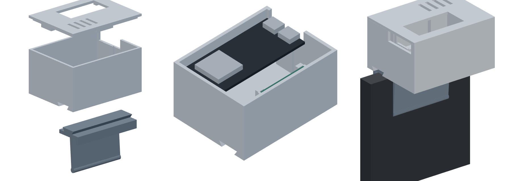

# Enclosure

A small box that sits on top of your monitor like a webcam. The radar looks out
through a thin front window; the ESP32-S3 board's USB-C ports come out on the
right.



Assembled: **69 × 53 × 39 mm** (without clip).

## Parts

Print the case, the lid and **one** clip that matches your screen (or the desk foot).

| Part | File | What it does |
|---|---|---|
| Case | [case.stl](case.stl) | Radar slot behind a 1.5 mm window, board supports, USB-C opening, dovetail groove underneath |
| Lid | [lid.stl](lid.stl) | Holds the board and radar down; window over the BOOT button and LED |
| Clip, 6 mm | [clip-6mm.stl](clip-6mm.stl) | Laptop lids and very thin monitors |
| Clip, 12 mm | [clip-12mm.stl](clip-12mm.stl) | Most thin-bezel monitors |
| Clip, 20 mm | [clip-20mm.stl](clip-20mm.stl) | Thicker monitors |
| Desk foot | [desk-foot.stl](desk-foot.stl) | Stand it on the desk under the monitor instead (tilts up 6°) |

Measure your screen's top edge where the clip will sit and pick the clip with
that number or the next size up. The rear leg leans in 4° (the gap at its foot
is about 2 mm narrower) and flexes, so the clip grips a slightly thinner edge
too.

## Printing

- PLA or PETG, 0.2 mm layers, 3 walls, 15–20 % infill. PETG for the clip if
  you have it (it flexes).
- No supports needed. Case: open side up. Lid: as exported (top on the bed).
  Clips: standing on their end, as exported. Desk foot: flat side down.
- **No metal-filled or carbon-filled filament** and no metallic paint on the
  front: 60 GHz passes through plain plastic only.

## Assembly

See [docs/wiring.md](../docs/wiring.md#into-the-case). Slide the clip into the
groove under the case from either side; it is a snug fit.

## Change the size

All parts come from [enclosure.py](enclosure.py) (CadQuery). Edit the numbers
at the top (board size, monitor thickness, window thickness) and run:

```bash
pip install cadquery
python enclosure.py
```

## License

[CC BY 4.0](LICENSE). You may print,
modify and share the files, including commercially, as long as you credit
Kymopsis.
